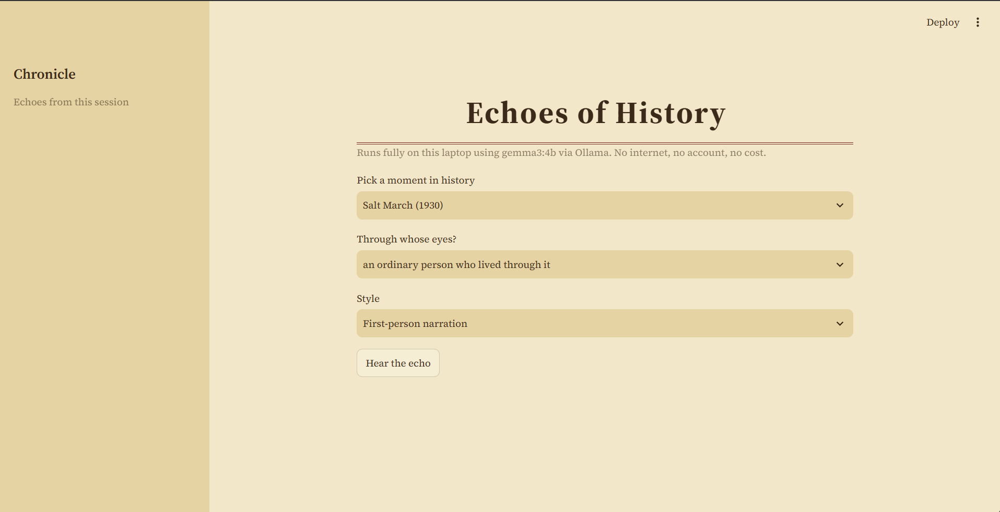
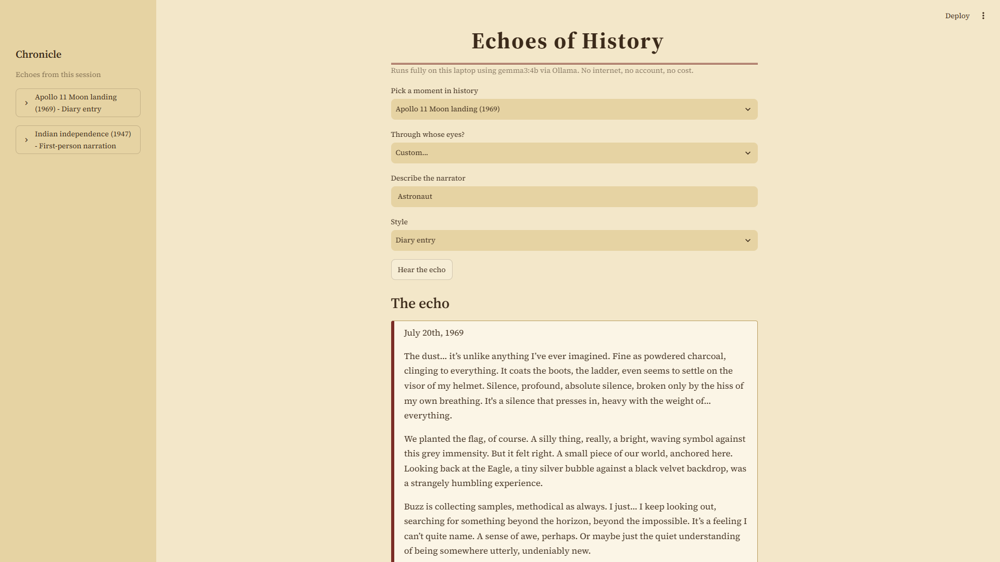
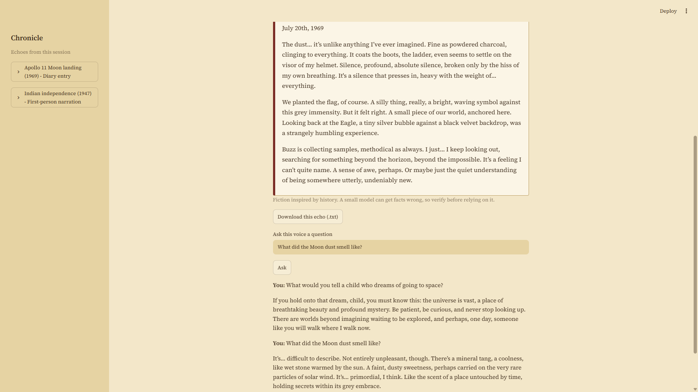
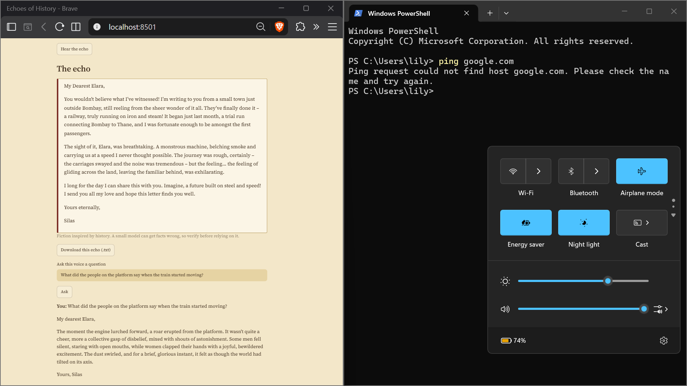
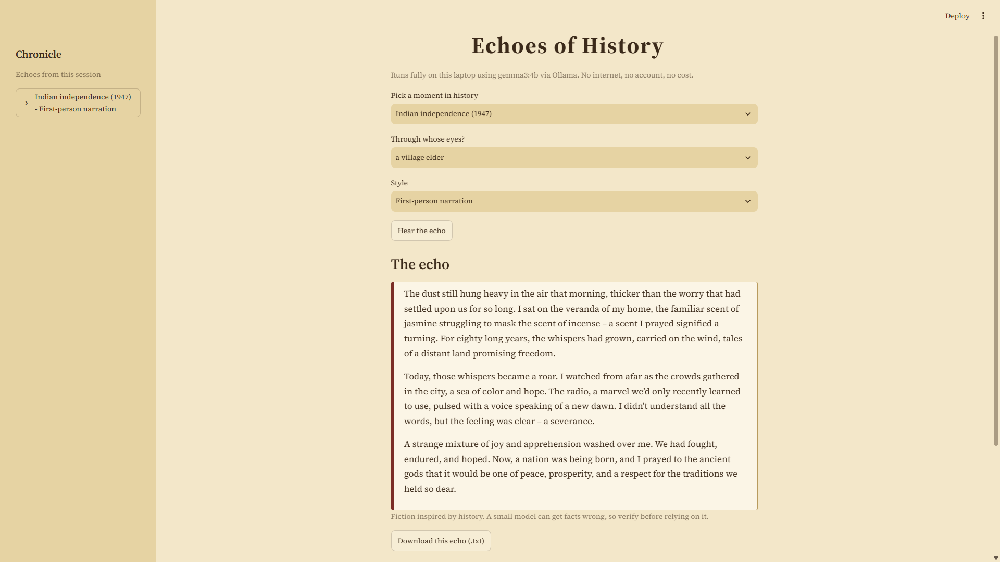

# Echoes of History

A small offline app that retells moments in history as short fiction, using an open-weight AI model running on my own laptop through Ollama. No account, no cloud, no cost.

Built for the **Hacktoberfest Open-Source AI Challenge, Week 4: Ghost in the Machine** (Oct 26 to Oct 31, 2026). I read the theme as "honoring the past": the app gives a voice to people who lived through historical moments.

## What it does

1. Pick a moment in history (or describe your own).
2. Pick who is telling it: a student, a shopkeeper, a village elder, a reporter, or a custom narrator.
3. Pick a style: first-person narration, short story, diary entry, or a letter to a loved one.
4. Click "Hear the echo". The model writes a short piece of fiction of about 150 words.
5. Ask the narrator a follow-up question and get an in-character answer.

## Features

- Five preset events plus a custom event option
- Six narrator presets plus a custom narrator
- Four writing styles
- Follow-up questions to the narrator
- A "Chronicle" sidebar that keeps the echoes from the current session
- A button to download an echo as a text file
- A parchment-style theme set in `.streamlit/config.toml`

## Why open-source AI?

- **It works offline.** Once Ollama and the model are downloaded, the app needs no internet. I tested it with airplane mode switched on (a ping to google.com failed), and the app still produced follow-up answers.
- **It costs nothing.** There is no API key, no account, and no usage bill.
- **Nothing leaves the laptop.** The text I type goes only to a model running on my own machine.
- **The model can be swapped.** To try a different model, change the `MODEL` line in `app.py`.

## How it works

`app.py` builds a prompt from your choices and sends it to the `gemma3:4b` model through the Ollama Python library on `localhost`. A system instruction tells the model to write fiction inspired by real events and not to invent specific dates, statistics, or named people. For follow-up questions, the earlier echo and your question are sent back to the model. The interface is built with Streamlit.

The model does not always follow that instruction (see the fact-check below).

## Run it

You need Python 3 and [Ollama](https://ollama.com). I ran it on a Windows laptop with 16 GB of RAM.

```
ollama pull gemma3:4b
pip install -r requirements.txt
python -m streamlit run app.py
```

Then open http://localhost:8501 in your browser. The first answer can take a while because the model has to load. If you use a different model name, update `MODEL` in `app.py` to match the name shown by `ollama list`.

## Project files

- `app.py`: the whole app
- `requirements.txt`: Python packages (`ollama`, `streamlit`)
- `.streamlit/config.toml`: the parchment theme

## Screenshots







## Limitations and fact-check

This is fiction inspired by history. A small model can sound confident and still be wrong, so I checked some details of its output against published sources.

### What the model got right

- **Apollo 11 diary entry:** The dust is described as fine like "powdered charcoal" and clinging to the boots. This matches Armstrong's own words in the NASA mission log.
- **Apollo 11 diary entry:** The date "July 20th, 1969" is correct for the landing. The model wrote a specific date even though my instruction said not to invent dates, so it was right by luck, not by following the rule.
- **Mumbai train letter:** The route (Bombay to Thane) and the year (1853) are correct. The first passenger train ran on 16 April 1853 between Bori Bunder and Thane, with about 400 passengers.

### What the model got wrong or could not support

- **What did the Moon dust smell like?** The model answered with "a mineral tang", "wet stone warmed by the sun", and "a faint, dusty sweetness". The Apollo crews reported something very different: spent gunpowder. Buzz Aldrin compared it to burnt charcoal or damp fireplace ashes. They also only smelled it inside the lunar module after bringing dust indoors, because they wore sealed suits on the surface. The model missed the gunpowder detail entirely and treated the smell as something noticed outdoors.
- **Mumbai train letter:** The narrator says the railway "began just last month, a trial run". The 1853 journey was the formal, public inaugural run. A separate trial run had taken place months earlier, around November 1852. The model blurred the two and invented the timing.
- **Follow-up: "What did the people on the platform say?"** The model described a collective gasp, women clapping, and dust swirling. I could not find sources for these details, and it left out a documented one: the inaugural journey was greeted by a 21-gun salute. It also did not give any actual words, which is what I asked for.

Lesson: the model is good at tone and atmosphere, but not at checking facts. The "verify before relying on it" note in the app is there for a reason.

## What I would build next

- A React frontend with a FastAPI backend that calls Ollama
- Answers grounded in openly licensed historical documents, so facts come from a source and not from the model's memory
- A simple timeline for each event

## Sources used for the fact-check

- NASA Apollo 11 mission log: https://www.nasa.gov/wp-content/uploads/static/history/ap11ann/apollo11_log/log.htm
- collectSPACE, "The smell of moondust (spent gunpowder)": https://www.collectspace.com/ubb/Forum29/HTML/000671.html
- Space Daily on Apollo crews and moon dust smell: https://spacedaily.com/t-apollo-moon-dust-gunpowder-lunar-hay-fever/
- Wikipedia, Thane railway station: https://en.wikipedia.org/wiki/Thane_railway_station
- The Quint, India's first passenger train: https://www.thequint.com/voices/blogs/165-yrs-later-heres-a-look-back-at-indias-first-passenger-train

Some of these are secondary sources, not primary documents, so treat the fact-check as a good-faith comparison, not a scholarly review.

## License

MIT
